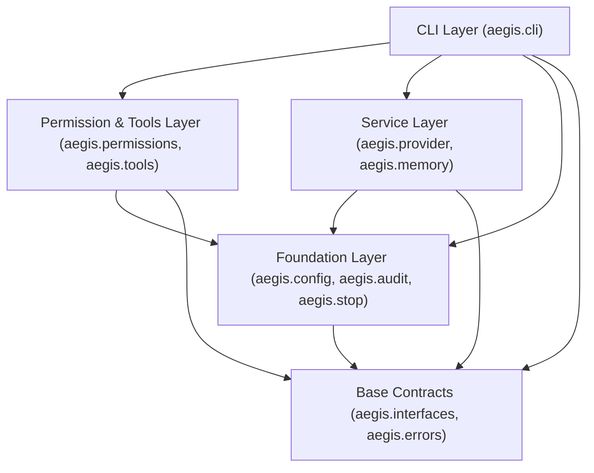
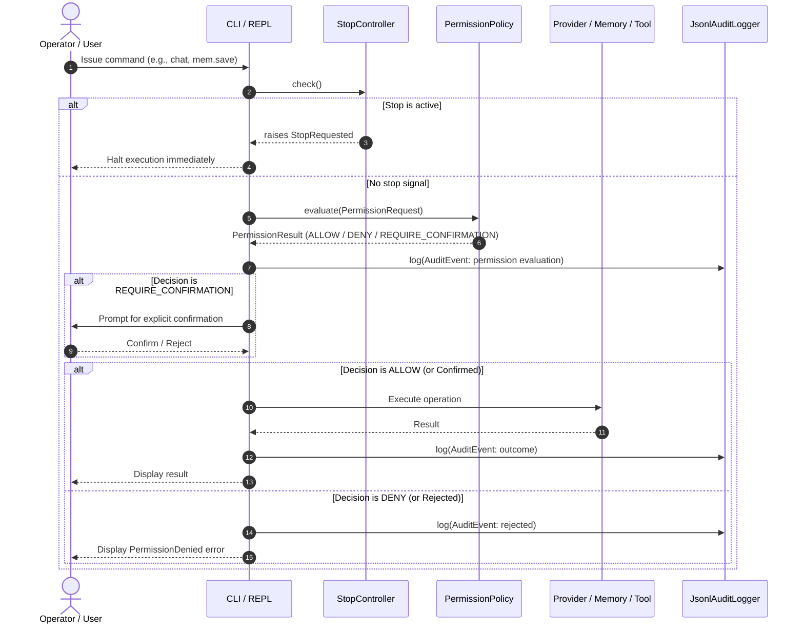

# Project AEGIS Architecture

AEGIS is a local-first, ethical AI agent prototype operating entirely on local infrastructure with strict determinism, privacy guarantees, and verifiable safety boundaries.

---

## 1. Module Map

```
aegis/
├── __init__.py          # Package initialization, version declaration (__version__ = "0.1.0")
├── __main__.py          # Module entry point delegating to aegis.cli.main:main
├── interfaces.py        # Shared protocols and data types (Decision, PermissionRequest, MemoryRecord, etc.)
├── errors.py            # Unified exception hierarchy (AegisError, ConfigError, StopRequested, etc.)
├── config.py            # AegisConfig dataclass, TOML parsing, env overrides, directory bootstrap
├── audit.py             # JsonlAuditLogger, read_events, InMemoryAuditLogger (JSONL audit sink)
├── stop.py              # StopController local stop file mechanism (STOP signal)
├── cli/                 # User-facing CLI subcommands, theme, and streaming rendering
│   ├── __init__.py
│   ├── main.py          # CLI command parser, dispatch, and stream execution
│   ├── theme.py         # AEGIS blue visual identity, theme tokens, headers, prefixes
│   ├── render.py        # Safe incremental StreamBuffer, Markdown and plain renderers
│   └── animations.py    # Capability-gated spinners, streaming indicators, completion
├── memory/              # Explicit SQLite-backed memory store
│   └── __init__.py
├── provider/            # Local model provider (Ollama HTTP client over 127.0.0.1)
│   └── __init__.py
├── permissions/         # Deterministic, explainable permission policy engine
│   └── __init__.py
└── tools/               # Local tool execution engine (sandboxed operations)
    └── __init__.py
```

---

## 2. Dependency Direction

The architecture enforces a strict layered, acyclic dependency model. Lower layers never import from higher layers.



### Dependency Rules:
1. **Base Contracts (`interfaces.py`, `errors.py`)**: Zero dependencies outside Python standard library. No other module in the codebase may be imported by `interfaces` or `errors`.
2. **Core Foundation (`config.py`, `audit.py`, `stop.py`)**: Depend only on Base Contracts and Python stdlib. Completely agnostic of CLI, providers, or specific tools.
3. **Domain Services (`provider/`, `memory/`, `permissions/`, `tools/`)**: Implement protocols defined in `interfaces.py` and raise exceptions defined in `errors.py`.
4. **CLI Layer (`cli/`)**: Orchestrates components via interfaces.

---

## 3. Data Flow

A typical operation proceeds through verification, execution, and auditing:



### Data Flow Invariants:
- **No Silent Actions**: Every consequential or security-sensitive request must be evaluated by `PermissionPolicy`.
- **Pre-execution Stop Check**: In-flight loops (such as multi-turn chat) invoke `StopController.check()` between turns.
- **Append-only Audit**: All evaluations, decisions, and execution outcomes produce an immutable `AuditEvent` written to JSONL.
- **Explicit Memory**: The agent never silently writes to the memory store during chat. Persistence only occurs through explicit `aegis memory save` invocations.

---

## 4. Sprint 001 Ownership & Deliverables

Sprint 001 employs strict file ownership boundaries across parallel workers:

| Deliverable / Path | Description | Owner |
|---|---|---|
| `pyproject.toml`, `.gitignore`, `README.md`, `docs/ARCHITECTURE.md`, `docs/SAFETY.md` | Build configuration, git hygiene, project documentation | Foundation Worker |
| `aegis/__init__.py`, `aegis/__main__.py` | Package root and module runner | Foundation Worker |
| `aegis/interfaces.py`, `aegis/errors.py` | Canonical protocols and exception hierarchy | Foundation Worker |
| `aegis/config.py`, `aegis/audit.py`, `aegis/stop.py` | Configuration, JSONL audit logger, stop signal controller | Foundation Worker |
| `tests/test_config.py`, `tests/test_audit.py`, `tests/test_stop.py` | Unit tests for foundation components | Foundation Worker |
| `aegis/memory/*`, `tests/test_memory.py` | SQLite-backed explicit memory storage and retrieval | Memory Worker |
| `aegis/provider/*`, `aegis/cli/*`, `tests/test_provider.py`, `tests/test_cli.py` | Ollama model provider integration and CLI commands | CLI / Provider Worker |
| `aegis/permissions/*`, `aegis/tools/*`, `tests/test_permissions.py`, `tests/test_tools.py` | Deterministic permission policy and sandboxed tools | Permissions Worker |
| `scripts/demo_sprint001.sh`, `docs/DEMO.md` | Integration end-to-end demonstration and walkthrough | Integration Worker |
